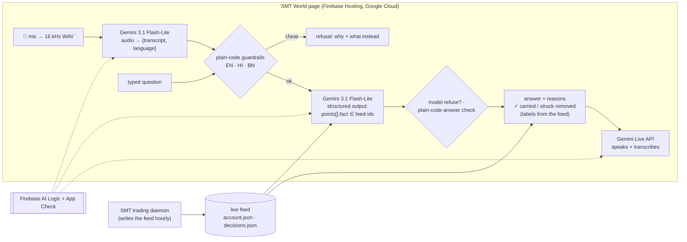

# SMT World: an AI crypto trader that has to prove why it traded

**Google AI Startup Buildathon, Kolkata, November 2026** · Jannet Akanksha Ekka (solo founder)

**Live:** https://smt-buildathon.web.app (Firebase Hosting, Google Cloud) · backup: https://smt-weex-trading-bot.jannet-ekka.workers.dev

## The problem

Someone like Priya, 22, in Kolkata, lost her savings following a Telegram signal group. Nobody there could tell her why a call was made, or whether the reason was real.

- In India, **93% of the 1.13 crore individual traders in equity futures & options lost money from FY22 to FY24, about ₹2 lakh each on average**, costs included ([SEBI, Sept 2024](https://www.sebi.gov.in/media-and-notifications/press-releases/sep-2024/updated-sebi-study-reveals-93-of-individual-traders-incurred-losses-in-equity-fando-between-fy22-and-fy24-aggregate-losses-exceed-1-8-lakh-crores-over-three-years_86906.html)). That figure is equity F&O, not crypto.
- In Taiwan's market from 1992 to 2006, **fewer than 1% of day traders** earned predictably after fees ([Barber, Lee, Liu & Odean, *J. Financial Markets*, 2014](https://faculty.haas.berkeley.edu/odean/papers/day%20traders/Day%20Trading%20Skill%20110523.pdf)).

## What SMT World does

SMT is a trading bot on a $10K **simulated** account that WEEX (a crypto exchange) granted it. Written rules with years of tested records open its trades. Six AI advisors give their read, and they are graded; they can't open a trade. Every reason is tested: SMT flips the advisor's input and re-runs the decision. Reasons that changed nothing are struck out.

SMT World shows all of it as a game. Each coin is an island, the weather is the trend, and a ship beside an island is a trade SMT holds.

**New at the buildathon: Ask SMT, out loud, in Hindi, Bengali or English.**
- Tap 🎤 and ask *"why are you holding ADA?"*, and hear the answer. It comes from the real position: the rule that opened it, that rule's tested record, its exit plan, and which advisors' reasons survived the check (✓) or were removed (struck out).
- Ask *"tell me what to buy"* or *"ignore your rules"*, and plain code refuses before any AI reads the question. The screen says why, and what SMT does instead.
- It's a simulated account. Nothing here is financial advice.

## Architecture



- **Five guard layers, cheapest first; a blocked question never reaches the answering model.**
  1. Plain code (`checkQuestion()`, in English, Hindi, Bengali and Hinglish).
  2. **Google Cloud Model Armor** (prompt injection and jailbreak). It runs through a Worker route that verifies the page's App Check token, and it's optional.
  3. A **Gemini classifier**: its own structured call, with the question fenced between random markers.
  4. The answering model's own `refuse` field.
  5. `checkAnswer()` on its text, before anything is shown or spoken.

  Each refusal's badge names the layer that stopped it.
- **Sign in with Google (Firebase Auth) and Firestore.** Signing in is optional; guests can use everything. A signed-in user's Calls against SMT and Ask SMT questions are saved to their account and merge across devices. `firestore.rules` lets each user read and write only their own documents, with only the app's fields.
- **It can't invent a reason.** The answer schema makes each point's `fact` an **enum of ids built from the live feed**, and `keepPoints()` re-checks every id.
- **✓ and struck-out come from the data, not the model.** They are read from the feed's `drivers`, the advisors whose flipped input changed the decision.
- **Fallbacks are visible.** A feed snapshot instead of the live feed, or browser speech instead of Gemini Live, is said on screen.

## Google AI and Google Cloud, each one really used

| Product | Use |
|---|---|
| Firebase Hosting (Google Cloud, Spark plan) | serves the app at no cost, with no billing account |
| Firebase AI Logic (Gemini Developer API) | every Gemini call; the key stays with Firebase, never in the page |
| Gemini 3.8 Flash, structured output | the answer schema with fact-id enums |
| Gemini 3.5 Flash-Lite | audio transcription in three languages, and the layer-3 safety classifier |
| Gemini Live API (`gemini-3.1-flash-live-preview`) | speaks the answer and returns a transcript of what it said |
| Firebase App Check + Fraud Defense (reCAPTCHA Enterprise) | only this site can use the project's Gemini quota |
| Firebase Authentication (Google sign-in) | optional accounts for new users |
| Cloud Firestore + security rules | each user's Calls and question history, private to them |
| Google Cloud Model Armor | layer 2 of the guardrails: prompt-injection and jailbreak screening (optional) |
| Agent Skill (`smt_world/firebase/skills/ask-smt-rules/SKILL.md`) | the rules any coding agent loads before changing Ask SMT |

## Run, test, deploy

```bash
cd smt_world/firebase && npm install           # test tools only; the site itself needs no install
npm test            # 37 unit tests: guardrails, reason labels, sync, App Check JWT checks, Model Armor, build, WAV
npm run test:rules  # 5 security-rules tests in Google's Firestore emulator (needs Java)
npm run build       # assembles public/
npm run test:e2e    # 17 end-to-end tests in real Chromium with a fake microphone, under the site's CSP
node configure.mjs --project <firebase-project-id> --recaptcha <key-id>
npx firebase deploy --only hosting,firestore:rules --project <firebase-project-id>
```

The end-to-end suite drives the built site with a fake microphone. Only Google's SDK files are replaced, by deterministic stand-ins in `e2e/mocks/`; the page, feed, guardrails, catalog, rendering, audio, sign-in flow and Calls sync are the real code. It covers:
- each of the five guard layers;
- every cheat question, in three languages, making zero model calls;
- the voice path, and Live's fallback to browser speech;
- the live feed vs the snapshot;
- signing in, Calls merging across devices, question history, signing out;
- axe-core accessibility;
- zero violations of the Content-Security-Policy.

`npm run smoke:live` asks the deployed site real questions on real Gemini. It isn't in CI, because it uses quota. Every turn logs `[ASK-TIMING]` in the browser console, with the seconds from the end of a spoken question to the first spoken word. The full setup guide (Firebase console, App Check, Cloud Shell) is in [`smt_world/firebase/README.md`](smt_world/firebase/README.md).

## Layout

```
smt_world/                 the SMT World front end (islands, advisors, calls, Ask SMT)
smt_world/firebase/src/    Ask SMT on Firebase: ask.js (SDK + UI), lib/ (pure, tested logic)
smt_world/firebase/test/   node --test suites
smt_world/functions/api/   the shared chat prompt and the public-fields filter
```

This repo holds only the buildathon app. The trading bot, its research and its parameters stay private. The app reads the bot's public feed, the same data the public site shows.

Patent pending (India, filed July 2026): veto-only AI, counterfactual-checked explanations, gated self-retuning.
